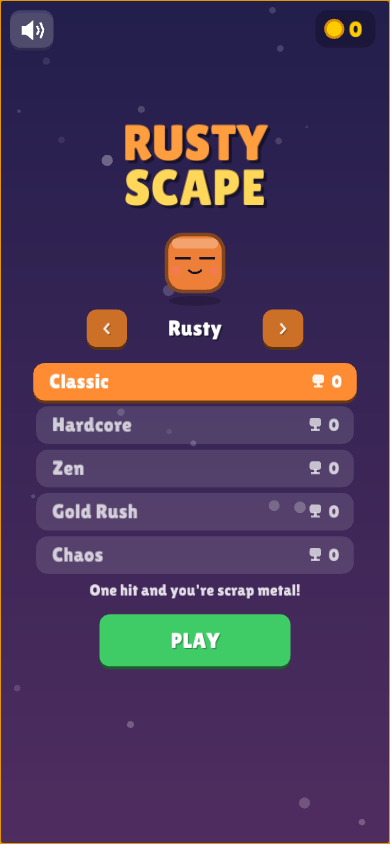

# Rusty Scape

A small arcade game written in Rust: blocks fall from the sky and you dodge them.

<p>
  
  
</p>


Built with [macroquad](https://macroquad.rs/), so the same code runs on **Windows, macOS, Linux and in the browser (WebAssembly)**. The browser version is made for phones too: it switches to a tall layout when the phone is held upright and has touch controls.

## Game modes

| Mode | What's different |
|------|------------------|
| **Classic** | The original. One hit and the run is over. |
| **Hardcore** | Faster blocks, more frequent waves, no power-ups. Scores count double. |
| **Zen** | Three hearts and a slower pace. Scores count half. |
| **Gold Rush** | A 60-second run where coins rain down. Grab as many as you can. |
| **Chaos** | Blocks come in every size, drift sideways and bounce off the walls. Scores count 1.5x. |

Each mode keeps its own high score. Progress is saved to disk on desktop and to `localStorage` in the browser.

## How a run plays out

- **Rain, then waves.** Blocks rain down for a while, then a **wave** hits, announced on screen: *Walls* (find the gap), *Zig-Zag*, *Sniper* (blocks aimed at you), *Stairs* or *Storm*. Surviving a wave pays a bonus and drops a rainbow of coins, then the rain comes back faster.
- **Fair warnings.** Every block is announced by an arrow and a faint lane at the top before it enters the screen.
- **Dash** through blocks with a quick burst of speed. It has a short cooldown, shown under your character.
- **Close calls**: brushing past a block gives bonus points and builds a combo multiplier (up to x3).
- **Power-ups**: shield (absorbs one hit), slow-mo, and magnet (pulls coins to you).
- **New best!** pops up the moment you beat your record, mid-run.
- **Coins are kept between runs.** Spend them on **8 skins** in the menu. The results screen shows how close you are to the next one.

## Controls

| Action | Phone / Mouse | Keyboard |
|--------|---------------|----------|
| Move | Drag anywhere (your finger never covers the character) | ← → or A / D |
| Dash | Tap | Space / Shift / ↑ / W |
| Pause | ⏸ button (top right) | P / Esc |
| Menu | Tap a mode, then PLAY | ↑ ↓ mode, ← → skin, Enter play, B buy skin |
| Sound / Fullscreen | Speaker button in the menu | M / F |

Phones also vibrate on hits, close calls and coins (where the browser supports it).

## Running locally

```bash
# Linux needs a few system packages:
sudo apt-get install libasound2-dev libx11-dev libxi-dev libgl1-mesa-dev

cargo run --release
```

Web version:

```bash
scripts/build-web.sh                       # outputs dist/web
python3 -m http.server -d dist/web 8080    # open http://localhost:8080
```

## Building for every platform

| Platform | Command | Output |
|----------|---------|--------|
| Web (HTML5) | `scripts/build-web.sh` | `dist/web/` |
| Linux / Windows | `scripts/build-native.sh` (run on that OS) | `dist/linux/`, `dist/windows/` |
| macOS (universal .app) | `scripts/bundle-macos.sh` (run on a Mac) | `dist/mac/Rusty Scape.app` |

You don't need all three operating systems: the GitHub Actions workflow (`.github/workflows/release.yml`) builds all four targets on every push. Download the results from the run's **Artifacts** section.

## Publishing to itch.io

### One-time setup

1. Create the project on itch.io (**Dashboard → Create new project**).
   - *Kind of project*: **HTML**
   - Save it once, even as a draft, so the URL exists (this game lives at <https://cracking.itch.io/rusty-scape>).
2. Generate a butler API key: <https://itch.io/user/settings/api-keys>.
3. In this GitHub repo, go to **Settings → Secrets and variables → Actions**:
   - Add a **secret** named `BUTLER_API_KEY` containing the key.
   - Optional: add a **variable** named `ITCH_GAME` set to `<itch-username>/<game-slug>`. It defaults to `cracking/rusty-scape` (<https://cracking.itch.io/rusty-scape>).

### Release

```bash
# bump `version` in Cargo.toml, then:
git tag v0.2.0
git push origin v0.2.0
```

The workflow builds all platforms and pushes each one to its own itch.io channel (`html5`, `windows`, `linux`, `mac`). It also attaches zips to a GitHub Release. You can also start it by hand: **Actions → Build & Release → Run workflow → publish_itch**.

### After the first upload, on the itch.io edit page

- Tick **"This file will be played in the browser"** on the `html5` upload.
- Tick the platform icons on the other uploads. itch usually detects them from the channel names.
- *Embed options*: viewport **960 × 640**, enable **Mobile friendly** (orientation: *Default*, since the game adapts to both) and the **Fullscreen button**. On phones itch.io opens the game full screen, where the tall layout kicks in.
- Suggested tags: `arcade`, `dodge`, `retro`, `rust`, `minimalist`.

### Manual upload (no CI)

Run `scripts/build-web.sh`, zip the **contents** of `dist/web` (so `index.html` is at the root of the zip) and upload the zip as an HTML file. Do the same with the desktop builds and mark their platform.

> **macOS note:** the app is not notarized, so on first launch players need to right-click → **Open** (or run `xattr -dr com.apple.quarantine "Rusty Scape.app"`).

## Project layout

```
src/
  main.rs     window config, procedural icon, main loop
  game.rs     game state, gameplay, menus, HUD
  modes.rs    game variants and player skins
  audio.rs    synthesized sound effects and music
  fx.rs       particles, floating text, banners, background
  ui.rs       adaptive (landscape/portrait) canvas, font, drawing helpers
  storage.rs  save data (file on desktop, localStorage on web) and vibration
assets/       Lilita One font (SIL Open Font License, see assets/OFL.txt)
web/          index.html + macroquad JS loader for the browser build
scripts/      build & packaging scripts
```

## License

See [LICENSE](LICENSE).
