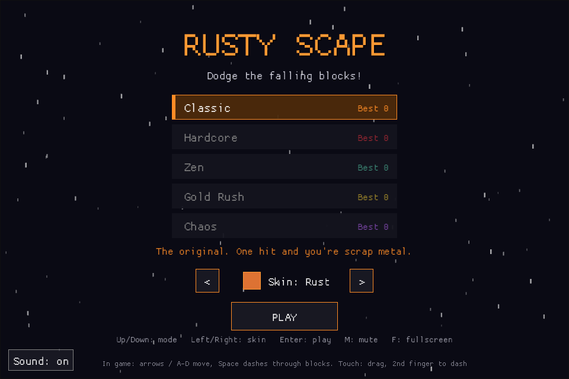
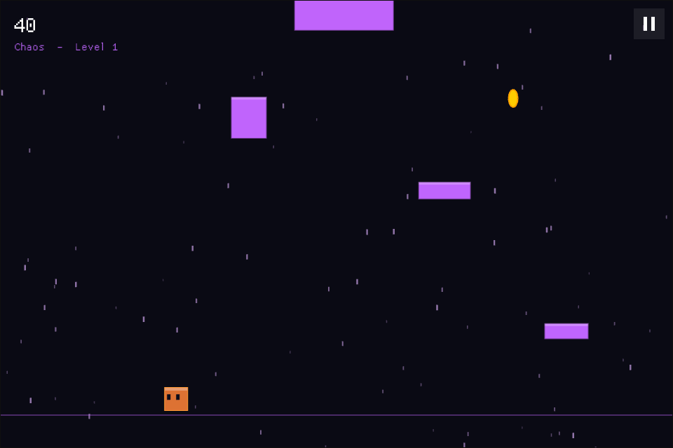

# Rusty Scape

A small arcade game written in Rust: blocks fall from the sky and you dodge them.




Built with [macroquad](https://macroquad.rs/), so the same code runs on **Windows, macOS, Linux and in the browser (WebAssembly)**. It also runs on phones and tablets in the browser.

## Game modes

| Mode | What's different |
|------|------------------|
| **Classic** | The original. One hit and the run is over. |
| **Hardcore** | Faster blocks, more of them, no power-ups. Scores count double. |
| **Zen** | Three lives and a slower pace. Scores count half. |
| **Gold Rush** | A 60-second run where coins rain down. Grab as many as you can. |
| **Chaos** | Blocks come in every size, drift sideways and bounce off the walls. Scores count 1.5x. |

Each mode keeps its own high score. Scores are saved to disk on desktop and to `localStorage` in the browser.

There are also **6 player skins** (Rust, Chrome, Neon, Ember, Violet, Gold). Pick one in the menu.

## Mechanics

- **Smooth movement** with acceleration, squash & stretch, and a bounce off the walls.
- **Dash**: a quick burst of speed. You pass through blocks while dashing, and it has a short cooldown.
- **Near misses**: brushing past a block gives bonus points and builds a combo multiplier (up to x3).
- **Pickups**: coins (points), shield (absorbs one hit), slow-mo (slows the world down for 4 s).
- **Difficulty** goes up over time: blocks fall faster and spawn more often, and wide slabs appear.
- Particles, screen shake, a parallax starfield, and sound effects synthesized in code (no asset files).

## Controls

| Action | Keyboard | Mouse / Touch |
|--------|----------|---------------|
| Move | ← → or A / D | Hold and drag |
| Dash | Space / Shift / ↑ / W | Right click / tap with a second finger |
| Pause | P / Esc | ⏸ button (top right) |
| Menu: choose mode / skin | ↑ ↓ / ← → , Enter to play | Tap a mode, tap it again (or PLAY) to start |
| Mute / Fullscreen | M / F | Sound button in the menu |

## Running locally

```bash
# Linux needs a few system packages:
sudo apt-get install libasound2-dev libx11-dev libxi-dev libgl1-mesa-dev

cargo run --release
```

Web version:

```bash
scripts/build-web.sh                       # outputs dist/web
python3 -m http.server -d dist/web 8080    # open http://localhost:8080
```

## Building for every platform

| Platform | Command | Output |
|----------|---------|--------|
| Web (HTML5) | `scripts/build-web.sh` | `dist/web/` |
| Linux / Windows | `scripts/build-native.sh` (run on that OS) | `dist/linux/`, `dist/windows/` |
| macOS (universal .app) | `scripts/bundle-macos.sh` (run on a Mac) | `dist/mac/Rusty Scape.app` |

You don't need all three operating systems: the GitHub Actions workflow (`.github/workflows/release.yml`) builds all four targets on every push. Download the results from the run's **Artifacts** section.

## Publishing to itch.io

### One-time setup

1. Create the project on itch.io (**Dashboard → Create new project**).
   - *Kind of project*: **HTML**
   - Save it once, even as a draft, so the URL exists (`https://<you>.itch.io/rusty-scape`).
2. Generate a butler API key: <https://itch.io/user/settings/api-keys>.
3. In this GitHub repo, go to **Settings → Secrets and variables → Actions**:
   - Add a **secret** named `BUTLER_API_KEY` containing the key.
   - Add a **variable** named `ITCH_GAME` set to `<itch-username>/<game-slug>`, e.g. `crstxkng/rusty-scape`.

### Release

```bash
# bump `version` in Cargo.toml, then:
git tag v0.2.0
git push origin v0.2.0
```

The workflow builds all platforms and pushes each one to its own itch.io channel (`html5`, `windows`, `linux`, `mac`). It also attaches zips to a GitHub Release. You can also start it by hand: **Actions → Build & Release → Run workflow → publish_itch**.

### After the first upload, on the itch.io edit page

- Tick **"This file will be played in the browser"** on the `html5` upload.
- Tick the platform icons on the other uploads. itch usually detects them from the channel names.
- *Embed options*: viewport **960 × 640**, enable **Mobile friendly** and the **Fullscreen button**.
- Suggested tags: `arcade`, `dodge`, `retro`, `rust`, `minimalist`.

### Manual upload (no CI)

Run `scripts/build-web.sh`, zip the **contents** of `dist/web` (so `index.html` is at the root of the zip) and upload the zip as an HTML file. Do the same with the desktop builds and mark their platform.

> **macOS note:** the app is not notarized, so on first launch players need to right-click → **Open** (or run `xattr -dr com.apple.quarantine "Rusty Scape.app"`).

## Project layout

```
src/
  main.rs     window config, procedural icon, main loop
  game.rs     game state, gameplay, menus, HUD
  modes.rs    game variants and player skins
  audio.rs    synthesized sound effects
  fx.rs       particles, floating text, starfield
  ui.rs       resolution-independent drawing & input helpers
  storage.rs  high-score persistence (file on desktop, localStorage on web)
web/          index.html + macroquad JS loader for the browser build
scripts/      build & packaging scripts
```

## License

See [LICENSE](LICENSE).
