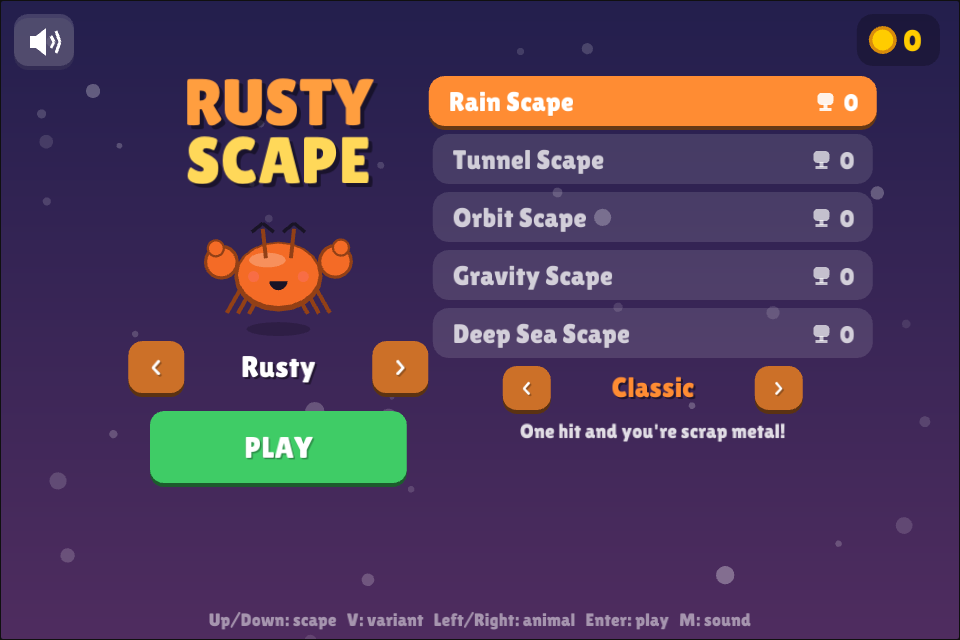
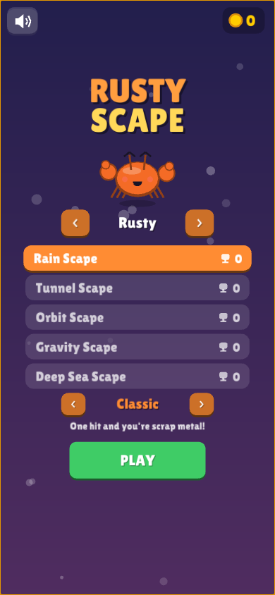
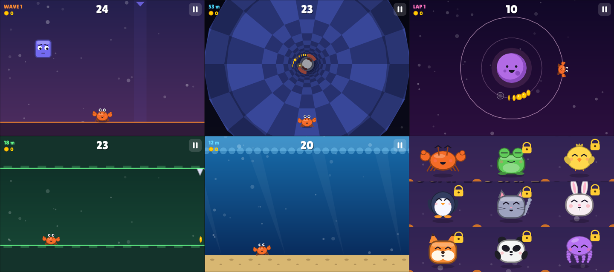

# Rusty Scape

A collection of small, casual "escape" arcade games written in Rust, starring Rusty the crab 🦀 and friends.

<p>
  
  
</p>



Built with [macroquad](https://macroquad.rs/), so the same code runs on **Windows, macOS, Linux and in the browser (WebAssembly)**. The browser version is made for phones too: it switches to a tall layout when the phone is held upright and has touch controls.

## The scapes

| Scape | How it plays | Phone | Keyboard |
|-------|--------------|-------|----------|
| **Rain Scape** | Blocks fall from the sky; run left and right to dodge. Waves of patterns (walls, zig-zag, sniper, stairs, storm) keep it fresh. | Drag to move, tap to dash | ← → / A D, Space to dash |
| **Tunnel Scape** | An endless round tunnel in pseudo-3D. Your animal stays at the bottom; **spin the tunnel** so the gaps come to you. Rings with one gap, wedges and spinning blades. | Drag left / right | ← → / A D |
| **Orbit Scape** | Circle a tiny planet and **hop between the inner and outer orbit** to dodge grumpy rocks. | Tap | Space / ↑ |
| **Gravity Scape** | Run down a corridor and **flip gravity** between floor and ceiling to avoid spikes. | Tap | Space / ↑ |
| **Deep Sea Scape** | **Hold to swim up**, let go to sink. Weave past jellyfish, kelp and fishing hooks. | Hold | Hold Space / ↑ |

Rain Scape has five variants, picked under the scape list:

| Variant | What's different |
|---------|------------------|
| **Classic** | The original. One hit and the run is over. |
| **Hardcore** | Faster blocks, more frequent waves, no power-ups. Scores count double. |
| **Zen** | Three hearts and a slower pace. Scores count half. |
| **Gold Rush** | A 60-second run where coins rain down. Grab as many as you can. |
| **Chaos** | Blocks come in every size, drift sideways and bounce off the walls. Scores count 1.5x. |

Every scape (and Rain variant) keeps its own high score. Progress is saved to disk on desktop and to `localStorage` in the browser.

## Coins and animals

- **One wallet for everything.** Coins from every scape go to the same purse.
- **Generous coins.** Coins come in trails, arcs and spirals in every scape, not just as rare singles.
- **Every run pays.** You keep the coins you grabbed plus **1 bonus coin per 50 points**.
- **Coins x2** power-up doubles every coin for 10 seconds.
- Spend coins on **9 animals**: Rusty the crab (free, a nod to Ferris, Rust's mascot), Froggo, Pip the chick, Waddles the penguin, Misu the cat, Hopper the bunny, Foxy, Bamboo the panda and Inky the octopus. They blink, look scared when something is about to hit them, and smile when they grab coins.

If you bought color skins in v0.3, their coins are refunded automatically.

## Shared mechanics

- **Close calls**: dodging at the last moment gives bonus points and builds a combo multiplier (up to x3).
- **Power-ups**: shield (absorbs one hit) and coins x2 everywhere; Rain Scape also has slow-mo and a coin magnet.
- **New best!** pops up the moment you beat your record, mid-run.
- Particles, screen shake, a slow-motion beat when you get hit, synthesized music and sound effects (no asset files).

## Controls

| Action | Phone / Mouse | Keyboard |
|--------|---------------|----------|
| Play | See each scape above | See each scape above |
| Pause | ⏸ button (top right) | P / Esc |
| Menu | Tap a scape, then PLAY (or tap it again) | ↑ ↓ scape, V variant, ← → animal, B buy, Enter play |
| Sound / Fullscreen | Speaker button in the menu | M / F |

Phones also vibrate on hits, close calls and coins (where the browser supports it).

## Running locally

```bash
# Linux needs a few system packages:
sudo apt-get install libasound2-dev libx11-dev libxi-dev libgl1-mesa-dev

cargo run --release
```

Web version:

```bash
scripts/build-web.sh                       # outputs dist/web
python3 -m http.server -d dist/web 8080    # open http://localhost:8080
```

## Building for every platform

| Platform | Command | Output |
|----------|---------|--------|
| Web (HTML5) | `scripts/build-web.sh` | `dist/web/` |
| Linux / Windows | `scripts/build-native.sh` (run on that OS) | `dist/linux/`, `dist/windows/` |
| macOS (universal .app) | `scripts/bundle-macos.sh` (run on a Mac) | `dist/mac/Rusty Scape.app` |

You don't need all three operating systems: the GitHub Actions workflow (`.github/workflows/release.yml`) builds all four targets on every push. Download the results from the run's **Artifacts** section.

## Publishing to itch.io

### One-time setup

1. Create the project on itch.io (**Dashboard → Create new project**).
   - *Kind of project*: **HTML**
   - Save it once, even as a draft, so the URL exists (this game lives at <https://crstxkng.itch.io/rusty-scape>).
2. Generate a butler API key: <https://itch.io/user/settings/api-keys>.
3. In this GitHub repo, go to **Settings → Secrets and variables → Actions**:
   - Add a **secret** named `BUTLER_API_KEY` containing the key.
   - Optional: add a **variable** named `ITCH_GAME` set to `<itch-username>/<game-slug>`. It defaults to `crstxkng/rusty-scape` (<https://crstxkng.itch.io/rusty-scape>).

### Release

```bash
# bump `version` in Cargo.toml, then:
git tag v0.2.0
git push origin v0.2.0
```

The workflow builds all platforms and pushes each one to its own itch.io channel (`html5`, `windows`, `linux`, `mac`). It also attaches zips to a GitHub Release. You can also start it by hand: **Actions → Build & Release → Run workflow → publish_itch**.

### After the first upload, on the itch.io edit page

- Tick **"This file will be played in the browser"** on the `html5` upload.
- Tick the platform icons on the other uploads. itch usually detects them from the channel names.
- *Embed options*: viewport **960 × 640**, enable **Mobile friendly** (orientation: *Default*, since the game adapts to both) and the **Fullscreen button**. On phones itch.io opens the game full screen, where the tall layout kicks in.
- Suggested tags: `arcade`, `dodge`, `retro`, `rust`, `minimalist`.

### Manual upload (no CI)

Run `scripts/build-web.sh`, zip the **contents** of `dist/web` (so `index.html` is at the root of the zip) and upload the zip as an HTML file. Do the same with the desktop builds and mark their platform.

> **macOS note:** the app is not notarized, so on first launch players need to right-click → **Open** (or run `xattr -dr com.apple.quarantine "Rusty Scape.app"`).

## Project layout

```
src/
  main.rs     window config, procedural icon, main loop
  game.rs     menu, shared run state (coins, combos, lives), HUD, results
  modes.rs    the scape list and Rain Scape's variants
  scape/      one module per game style (rain, tunnel, orbit, gravity, sea)
  art.rs      the animal cast, faces, pickups and icons, all drawn in code
  audio.rs    synthesized sound effects and music
  fx.rs       particles, floating text, banners, background
  ui.rs       adaptive (landscape/portrait) canvas, font, drawing helpers
  storage.rs  save data (file on desktop, localStorage on web) and vibration
assets/       Lilita One font (SIL Open Font License, see assets/OFL.txt)
web/          index.html + macroquad JS loader for the browser build
scripts/      build & packaging scripts
```

## License

See [LICENSE](LICENSE).
